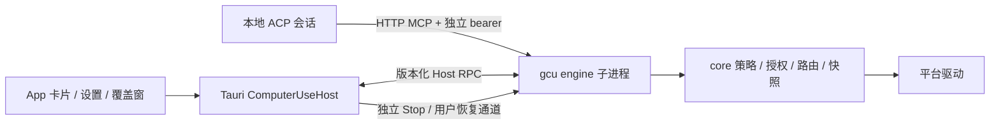

# Computer Use v2（路线 B）

维护 App 的 Computer Use 时先读本页，再读 [03 技术架构](../plans/computer-use-v2/03-architecture.md)、
[05 集成规格](../plans/computer-use-v2/05-route-b-integrated.md) 和 [ADR](../../computer-use/docs/adr/)。
架构接口或信任边界变化必须先获得维护者批准并写 ADR。

## 入口与交付边界

- 设置入口：扩展 › Computer Use；设置键 `computer_use_enabled`，默认关闭。
- 发布档位只读。没有满足 07 §8 的 gcu-eval runner 报告时保持实验，默认不改为正式；性能基准不能代替 runner。
- 设置深链 `#/settings/extensions/computer`；登记见 [settings-ia.md](settings-ia.md)。
- 聊天流使用 App 授权卡、敏感确认卡、交接卡与工具调用卡；覆盖窗提供停止和用户恢复。
- 仅启用的本地会话可注入。SSH、Remote IM、定时任务、official-aux 均不注入。
- 平台能力以引擎 doctor/capabilities 为准；当前原生引擎组装、Computer 面板、设置页、内置浏览窗等交付状态见
  [STATUS](../plans/computer-use-v2/STATUS.md)。未完成的能力保持关闭，不能把 fake 测试当作真机支持证明。
- 不读取、不迁移、不删除 v1 实验数据；不改真实 `~/.grok` 配置。

## 架构



- `src-tauri` 只依赖 `gcu-protocol`、`gcu-host-protocol`；不得链接 core、MCP 或驱动。
- 可测状态机、生命周期、审批、图片归属与覆盖层安全在 `computer-use/`；Tauri 只作薄适配。
- 一个 App 托管一个引擎；每个 App session 有独立随机 token、授权、队列、快照和图片命名空间。
- 引擎只能由 App 验证签名/构建身份后启动。外部引擎限独立 Dev 身份与授权。
- 首选继承私有连接，回退需双向证明和预期进程实例校验；同 UID/文件权限不是可信身份。
- bearer 只进 ACP HTTP Authorization header，或回退的继承 FD；不进 argv、环境、普通日志或崩溃报告。
  ACP 自身必然收到 header；所有载荷日志必须经过协议 crate 的 scrub。
- loopback Host 必须精确单值 `127.0.0.1:<实际端口>`；Origin 如有则只允许对应 HTTP 源。

## 授权与安全

- 读取 App 内容也需要授权；只列 App/窗口名称不等于授权读取窗口内容。
- 授权档位为本轮、本会话、始终允许、拒绝；超时默认拒绝。
- 始终允许只在真实用户审批事件中单次消费后持久化；绑定会话、App 映像、引擎实例与策略版本。
- 持久授权不因普通轮次/会话关闭删除；撤销从设置页执行并通知引擎更新策略。
- 敏感确认绑定窗口、参数、快照、fingerprint 与策略版本；投递前重验。变化后重新观察、重新审批。
- 模型理由只作纯文本辅助，处理双向控制字符；身份来自 OS 核验，名称和图标不作凭证。
- 终端、凭据管理器、系统安全提示、App 自身拒绝；IDE 或网页内的执行界面无法隔离时 handoff。
- 不确定执行结果返回 `unknown`，不得自动重试；不因定向输入失败静默升级为前台输入。
- 截图及裁剪/缩略图均来自脱敏结果；原生树不完整或敏感区无法定位时拒绝出图并 handoff。
- 图片按会话验证归属，预览走 [loopback + path resolve](media-delivery.md)；不信任模型输出的图片路径。

## 生命周期（不可绕过）

| 边界 | 必须发生 | 必须保留 |
|---|---|---|
| ACP prompt RPC 结束（成功、错误、取消） | `engine.session.turnEnded`；拒绝本轮挂起审批；清本轮授权、释放输入、隐藏光标、下次观察全量 | 会话授权、用户 Stop |
| 关闭/删除、fork、切模型或提供商 | `engine.session.close`；撤销旧 token/会话授权/快照/图片及待处理审批，关闭已启用的会话资源 | 持久授权、用户 Stop |
| 普通切换聊天焦点 | 按 session_manager 原有规则 park/demote；不关闭忙碌聊天 | 原会话及审批 |
| 引擎断线/换代 | 立即使 Host 缓存端点失效，清审批与图片；下次空闲连接重建 ACP MCP 注入 | Host 持久 Stop |
| 用户 Stop | 先锁存，再经独立控制通道释放输入；拒绝待审批动作 | 重连/重启仍停止 |
| 用户明确恢复 | 仅可信 UI 独立控制通道，校验新序号及用户事件；失败保持锁存 | 无自动恢复 |

- 生命周期 owner 是 `gcu_host_protocol::lifecycle::Lifecycle`，生产和测试用同一实现。
- 连接与发送入口都校验过期 MCP 目录；ready UI 跳过 connect 时也必须先重连再发 prompt。
- ACP 只在 prompt RPC 终态转发轮次结束；早到的 `PromptComplete` 通知不能截断仍在进行的工具调用。
- 轮次凭据绑定本次 prompt；重复通知、旧 prompt 的迟到回调、旧引擎断线均不能清理新会话。
- 关闭先撤销 Host 能力再等待引擎；RPC 失败/取消时关闭连接，不能遗留仍可调用的旧端点。
- 已启用的 portal/restore token、订阅及 worker 由引擎会话关闭路径清理；未组装的平台路线保持禁用。
- App 图片索引立即拒绝旧会话读写，文件在阻塞 worker 清理；关闭后到达的旧全图响应不得重新入库。
- `cu://session-closed` 清前端图片缓存与打开的预览；普通焦点切换不发送此事件。
- Stop 跨轮、排队调用、会话重连、引擎重启和功能开关保持锁存。
  模型下一条消息、handoff“已处理”和普通生命周期事件都不能解除。
- **`engine.session.resume` 永不注册为模型 MCP 工具。** 只保留可信用户 UI/CLI 恢复入口。

## 实现约束

- 不给 `App.tsx` / `AppWorkbench.tsx` 加状态；session_manager 只增加边界挂钩，不重构核心流程。
- 新文案源于 `computer-use/ui/locales/*.json`（15 语言锁步），用 `xtask ui export-i18n` 生成 App catalog。
- 不用 native confirm/select、透明菜单或可穿透的错误层级；复用 App 对话框与菜单组件。
- `cu-overlay`、`cu-overlay-controls` 使用独立最小权限；远程 `cu-browser` 不得获得可信 App IPC/媒体/审批权限。
- 不新增后台恢复工具、通用 HTTP 控制后门、凭据环境变量或真实账号测试。

## 验证

编译遵循 [执行规程](../plans/computer-use-v2/08-grok-execution-protocol.md)，远程构建一次只跑一个。
在 `computer-use/`：

```sh
cargo fmt --all -- --check
rcargo test -p gcu-core --test stop
rcargo test -p gcu-host-protocol
rcargo run -q -p xtask -- check-deps
```

App（匹配平台构建机，在 `src-tauri/`）：

```sh
cargo test -p grok-app computer_use::lifecycle
cargo clippy -p grok-app --all-targets -- -D warnings
```

仓库根目录：

```sh
corepack pnpm exec vitest run src/components/computer-use/ComputerUseToolCard.test.tsx src/lib/computer-use/events.test.ts src/lib/api/computerUseShot.test.ts
corepack pnpm exec tsc --noEmit
```

真实 TCC、原生焦点/穿透/截图排除、Wayland portal 及停止时限由匹配桌面 runner 验证；未运行写 `not_run`。
