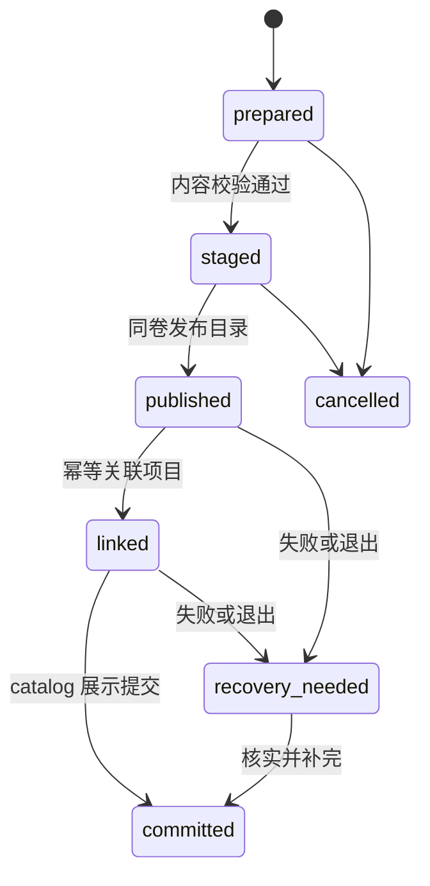

# 会话导入实施契约 v0.2

2026-09-08。**设计草案，未实现。** 对应[主方案](2026-09-08-session-workspace-import.md)与[验收矩阵](2026-09-08-session-workspace-import-acceptance.md)。本文冻结设计决策；资源数值和版本兼容表仍需 P0 实验后确认。

## 1. 对象身份、修订与图关系

| 对象 | 身份与约束 |
|---|---|
| SourceInstallation | 一次登记的来源实例：provider + 随机 installationId + profile + source host。重选同一源可显式关联，不用用户名、磁盘盘符或内容 hash 冒充设备身份 |
| SourceSession | `(installationId, provider, nativeSessionId)`；无 native ID 时给规范化相对 locator 分配稳定内部 ID。相同内容的两个不同会话仍是两个对象 |
| ImportEntry | `imp:<uuid>`；可有多个 revision、一个 currentRevision、本地显示别名和隐藏标记；不在原生 sessions_index 中 |
| SourceSnapshot | 有界固定输入，包含相关文件/DB 的来源摘要、稳定读证据、完整前缀位置和取样时间；排除 mtime 等易变信息后的正文摘要用于内容判断 |
| ImportRevision | 选定来源逻辑资料摘要 + normalizerVersion + 保留/过滤选项摘要。不同解析器/排除策略不得复用旧投影；内容无变化的重新扫描复用原 revision |
| Branch / relationship | parent-message、fork、subagent、compaction、rollback 分别存关系类型；不能都混成一个 parentId。会话内 ID 和跨会话 ID 使用不同命名空间 |
| ContinuationRef | Grok appSessionId → importId + 固定 revision + branch leaf + allowedSelectionHash + handoffHash。源刷新不改变已发出的上下文 |

sourceSnapshotId 基于**选中会话的逻辑记录**和附件目录，不基于整个 Cursor global DB 字节，否则其他聊天变化会使所有 revision 失效。原始读取时的数据库/文件摘要另作一致性证据。canonical serialization 版本写入 manifest；整数、JSON 字段序、换行处理必须有固定 fixture。

事件 ID 优先保留来源自带身份并加来源命名空间。无 ID 时使用 source artifact + record/block locator 的确定性 ID；相同文本的多次真实发送保留多次。只有已知协议中属于同一输出的增量/最终记录才合并，并保存 contributingSpans。跨快照定位发生变化而无法可靠对齐时，生成新 revision，不虚构稳定事件身份。

### 最小事件类型

以下类型说明持久化数据的约束；实际 Rust/TS DTO 从同一 schema 生成或做协议回归，不分别维护含义不同的类型。

```ts
type Json = null | boolean | number | string | Json[] | { [key: string]: Json };
type SourceSpan = { artifactId: string; record: string; block?: number };
type PayloadRef = { blobId: string; mediaType: string; byteLength: number };
type ContentBlock =
  | { kind: "text" | "code"; text: string; language?: string }
  | { kind: "asset"; assetId: string; alt?: string }
  | { kind: "visible-reasoning"; text: string }
  | { kind: "opaque"; sourceType: string; payload?: PayloadRef };
type EventBase = {
  id: string; ordinal: number; spans: SourceSpan[];
  timestamp?: string; timeOrigin: "source" | "file-hint" | "unknown";
};
type ImportedEvent = EventBase & (
  | { kind: "message"; role: "user" | "assistant" | "system";
      blocks: ContentBlock[]; complete: boolean }
  | { kind: "tool-call"; callId: string; name: string;
      input: Json | PayloadRef; parentMessageId?: string }
  | { kind: "tool-result"; callId: string; blocks: ContentBlock[];
      outcome: "success" | "error" | "cancelled" | "unknown" }
  | { kind: "compaction"; summary: ContentBlock[];
      coveredEventIds?: string[]; coverageKnown: boolean }
  | { kind: "metadata"; sourceType: string; payload?: PayloadRef }
  | { kind: "unsupported"; sourceType: string; payload?: PayloadRef }
);
type EventRelation = {
  kind: "parent" | "fork" | "subagent" | "compacts" | "rolls-back";
  from: string; to: string; confidence: "explicit" | "inferred";
};
```

`input` 的 JSON / payload 引用实现时使用有 tag 的编码，避免工具参数恰好含 blobId 时歧义。所有结构化参数限制深度/尺寸；大输出用 blob 引用，不能把无限大 JSON 塞进 IPC。未知事件使用 unsupported，损失计数单列。可见 reasoning 仅为源文件实际可读文本，不包括加密块或不可得的模型状态，默认不发送到新模型。

graph 校验包括 ID 唯一、父环、缺父、工具作用域（会话 + 分支 + callId）、摘要覆盖范围、回退可达性。不能确定活动分支时保留树并让用户选择；缺少祖先时允许部分阅读，但交接标记“历史链不完整”。时间不负责决定因果顺序，排序以来源 ordinal/关系为准。

### 工作区类型

`SourceWorkspace` 保留 `sourceWorkspaceId, displayName, roots[], defaultRootId?, evidence[]`；每个 root 含 `pathSyntax(windows|posix), host(local|wsl|ssh|unknown), originalPath, availability, evidence`。`WorkspaceMapping` 单独保存 `rootId → targetProjectId | explicitTarget | unassigned` 和用户选择版本。

Cursor `.code-workspace` 相对 roots 以 workspace 文件目录解析；无法读取引用文件时保留 unresolved，不尝试 cwd 猜测。离线 Windows 路径在 macOS 上也以 Windows 语义处理。目录大小写按实际卷语义核实，不能“一律 Windows 小写、macOS 保留大小写”代替身份校验。仅凭路径文本匹配的附件先显示候选，不自动打开同名文件。

## 2. 标准化、完整性与权限边界

每个 adapter 返回 `SourceEvidence + NormalizedGraph + Inventory + ImportIssues`，不是只返回消息数组。

| 字段 | 含义 |
|---|---|
| Inventory | discovered/selected/imported/deduplicated/unsupported/excluded/missing；分别统计消息、工具调用、结果、附件和子会话 |
| expectedCount | 来源可证实的完整计数，否则 null。禁止用解析出来的数当预期数 |
| outcome | complete：选定范围无未解释损失；partial：存在未知/丢失；unsupported：无法识别可用正文；failed：运行/IO 阻断 |
| scope | 用户明确选择的会话/分支/附件；子代理数、源归档状态、时间筛选单独显示 |
| rawRetention | selected-records 或 normalized-only；后者不承诺字节级重建源文件 |

成功是相对用户已确认范围，但**不能默默把不支持项挪进 excluded**。例如选择导入 10 张图、只读到 8 张，必须是 partial；用户明确未选图片则是排除项，不报图片导入成功。源码中的隐藏系统提醒可归 metadata，在阅读器折叠，仍计数说明。

资产表使用 `assetId,digest,mime,size,state,sourceSpan`，state 为 stored/missing/excluded/oversize/unresolved。仅复制明确在允许根内且被选中的附件；未解析路径、URL、SSH 文件不自动抓取。媒体显示使用已有 loopback resolver；导入数据中的 `file://`、`[[chat:...]]`、`[[skill:...]]` 等仅作为来源文本，不进入 App 内部指令/附件展开器。用户显式“打开关联”才通过相应 resolver 校验。

导入数据在阅读界面只读，不等于对同一 OS 用户建立文件沙箱。模型工具的范围控制适用于这两个历史工具，不能保证已获 shell 权限的同用户进程无法读取本地文件；保持现有沙箱/项目权限语义，不在产品宣称额外的 OS 隔离。

## 3. 目录、提交、删除与恢复

catalog 使用独立 schema_version 与 migration log。至少含 sources、entries、revisions、workspaces、mappings、jobs、job_items、receipts、continuation_refs、tombstones；页偏移/全文索引是可重建派生数据。唯一约束：source session 身份、`(entryId, revision)`、`(jobId, candidateId)`、创建子会话的 requestId。损坏时显式报错并保留文件，不能把数据库重置为空假装无历史。



各阶段 receipt 含目标 ID、资料摘要、project create/match 决策与前置 revision、每一步完成标记。所有路径先校验位于 imports 或明确新建的 session 目录；目录发布后禁止覆盖，同一目标存在则比 hash。原子 rename 不等于断电持久性，数据 flush 与平台目录同步行为需要故障实验后记录，首版不能宣称未经测试的断电无损。

每个 app_data root 只有一个导入提交协调器（进程内队列 + 进程间锁），读取/预览可并发。不要在 SQLite transaction 内调用 `store_lock`，也不要嵌套持有多个 store 锁；当前 store_lock 使用单进程互斥量，嵌套可能死锁。项目关联、catalog 更新用短事务和 receipt 衔接，长扫描/哈希/附件 IO 在锁外进行。

| 崩溃位置 | 重开后的处理 |
|---|---|
| receipt 前/仅 staging | 不出现导入记录；清理已确认由本作业拥有的临时目录 |
| published 但未 linked | 核对 hash 和 tombstone 后继续既定本地关联，不重新读源；已取消/删除的对象不能复活 |
| 项目已创建、catalog 未完成 | 检查同一目标身份；重用已创建项目；若用户已修改项目则保留用户状态并报冲突 |
| catalog 已 committed、通知未发 | `job_get` 返回完成事实，UI 不重复提交 |
| 子会话 receipt 已写 | 使用预分配 appSessionId；核实旁车和 journal 后补索引，不重新 create_session |

未发布项目只属于计划；无法关联项目时，可在用户事先选择“关联失败仍导入历史”后提交 unassigned 并报告，否则该项进入待处理。无计划依据不擅自改变归属。

### 删除语义

- “隐藏历史”只改变显示；“删除导入”清除目录记录并写 tombstone，源工具中的会话不动。刷新扫描默认显示已删除来源为“曾删除”，用户选重导入才取消该 tombstone。
- 作业取消保留 committed 项；撤销作业仅撤销该作业创建的最新关联/版本，既有导入条目不得整体删掉。原版本或项目发生用户修改时显示冲突，不覆盖。
- 快照被续聊或其他 revision 引用时，删除目录项仍保留该资料并说明原因。用户要彻底移除其内容，必须处理所有引用的子会话；不能自动级联删除活会话。
- 未引用历史版本提供手动清理预览，首版没有静默到期删除；关闭应用后临时源 DB 快照可清理，已提交来源资料不因源应用保留期限变化而消失。
- 创建的空项目仅在无后续会话/无外部引用/无用户修改时可由撤销移除记录，绝不删除工程目录。Space、既有项目的名称/顺序/信任均不复写。
- 旧 App 不识别导入 catalog，只看普通 Grok 子会话。升级后的本程序发现更新的 catalog schema 时只报不兼容，不降级写库；版本发布须说明旧 App 的子会话恢复可能缺少外部上下文。不能靠一个新字段阻止已安装旧二进制操作普通会话。

普通 Grok 子会话被旧版本删除后，目录清理只可将其引用标为待复核；不得立即垃圾回收仍可能被另一个子会话使用的快照。通过幂等引用审计修复旁车/catalog 差异。

## 4. API、状态与 UI 竞态

下面是拟实现的 Tauri 命令，名字/字段在 P0 schema v1 固定。path 只允许 Host 文件选择器或验证过的手动根进入 source registration；后续命令全用不透明 ID。

| 命令 | 关键输入 → 输出 |
|---|---|
| `session_import_scan_start` | sourceIds, filters → scanId, epoch；返回即开始后台扫描 |
| `session_import_scan_page` | scanId, epoch, cursor, limit → candidates, nextCursor, discoveredCount, complete |
| `session_import_scan_get` / `scan_cancel` | scanId, epoch → 扫描阶段/计数/序号；显式取消停止扫描，不取消已经独立提交的 job |
| `session_import_preview` | candidateId, expectedSourceRevision → 固定快照 previewId、首屏、inventory/issues |
| `session_import_plan` | previewIds/选中快照集合、workspace mappings、保留选项 → planId, planHash, 空间估计及逐项操作 |
| `session_import_commit` | planId, planHash, requestId → jobId；相同 requestId/plan 返回同作业，内容变化拒绝 |
| `session_import_job_get` | jobId → 全阶段计数、逐项结果游标、eventSeq、状态 |
| `session_import_cancel` / `retry` / `undo` | jobId, expectedStateVersion, requestId → 新状态或新作业；不重跑成功项 |
| `session_import_entries` / `events` | entry/固定 revision/branch、cursor、limit → 分页；cursor 绑定版本和筛选 |
| `session_import_search` / `export_markdown` | query 或 entryId/revision/leaf → typed hits 或 Host 选择位置后的可读文件；不调用模型 |
| `session_import_continue_prepare` | entryId, revision, leaf, 选取范围、目标项目 → handoffDraftId, coverage, runtimeCapability |
| `session_import_continue_create` | draftId, draftHash, requestId → appSessionId；只创建和打开待发送草稿，不自动模型调用 |

`continue_create` 后用户在普通 composer 最终发送；重复点击“继续”恢复同一草稿，不重复建会话。修改选定分支/项目/范围使旧 draftHash 失效；同一来源可显式“另开一个续聊”，使用新 requestId。preview/plan 有过期时间，正在生成计划或执行中的 job 持 lease；计划到期返回 PLAN_STALE，不能使用已清理的临时快照。

作业状态：queued/running/cancelling/completed/completed_with_issues/cancelled/failed/recovery_needed；条目状态与 phase 分开。取消是作业终态，不把已完成项改成 failed；取消中的 UI 不说已全部停止。扫描会话数、导入条目数、字节进度分别显示；未知 total 时使用已完成计数，不显示假百分比。

事件名 `session-import://changed`，只带 jobId/scanId、epoch、eventSeq 和短计数，不带正文或源凭据。UI 先订阅缓冲→拉状态(seq N)→只应用 N 后事件；事件序号跳跃/重开窗口/Host 重启时重拉状态。Host 不需要永久存每条 progress event。筛选、预览与 job 各用独立 generation；迟到预览绝不改写正在看的其他会话。

“全选”不能只选已加载的第一页。扫描未完时先固定发现集版本并显示 N 项，后续条目显示“另有新发现”，用户刷新后再加入。commit 开始后新扫描和设置修改不能改变已确认 plan。源 revision 与 plan 不一致则返回 SOURCE_CHANGED；不依靠一次 mtime 相同放行。

稳定错误码至少包括：SOURCE_NOT_FOUND、SOURCE_PERMISSION_DENIED、SOURCE_BUSY、SOURCE_CHANGED、SNAPSHOT_UNAVAILABLE、FORMAT_UNSUPPORTED、SCHEMA_UNSUPPORTED、PARTIAL_HISTORY、WORKSPACE_UNRESOLVED、MAPPING_CONFLICT、RESOURCE_LIMIT、DISK_SPACE_LOW、PLAN_STALE、IMPORTED_HISTORY_READ_ONLY、HISTORY_ACCESS_UNAVAILABLE、DISPATCH_UNKNOWN、IMPORT_SCHEMA_TOO_NEW。每个错误附重试类型/作用范围，UI 映射 15 语言，原始错误只在可展开诊断中脱敏显示。

## 5. JSONL、SQLite 与跨来源一致性

JSONL 以流式固定完整前缀建立 snapshot。源文件大小增长时可保留已完整读取的前缀，但 prefix hash 必须核对；中间改写、截断、替换 inode/文件身份则作废。不要要求活会话整文件一直不变，也不要把任意坏行当作未完成尾行跳过。

SQLite 使用只读连接、短事务/online backup。查询不能执行用户 SQL 或触发扩展加载；只查白名单 table/key/schema。记录逻辑 revision、读取时间与 inventory，读源期间禁止任何写 SQL、repair 或 VACUUM。数据库各自的一致快照不代表多个 DB 的共同时间点。

Cursor Composer 组合工作区索引与全局正文时：先取得参与源的一致视图→核对每个 composer/bubble 引用→对悬空或变化项有界重试一次→仍不完整则报告 partial/来源变化，不把不同版本消息按时间直接拼在一起。可独立获取正文的 global entry 可显示为待映射会话；工作区映射未知不丢正文。

Store DB、Composer DB、transcript 发生重复时，以相同原生身份与可验证 lineage 聚合候选。一种正文来源稳定且完整就使用该版本；只有另一源可补上有明确 ID 的缺失附件/元数据时才补齐。文本相似、时间相近只能是重复候选，不能据此自动拼消息。tools/input/result 必须作为同一来源版本的相关记录对待。

跨 Codex legacy rollout / paginated projection 也使用相同原则：adapter 能证明完整重建才标 complete。识别出新格式但只读到摘要时显示 metadata-only，不用旧格式 parser 给出空聊天。

## 6. 续聊、MCP 与派发语义

### 可发送范围与交接

`AllowedSelection` 保存 eventId 集合或固定 branch 下的区间，以及字段/资产许可；用户排除的部分对交接、摘要、工具检索、附件展开使用**同一份**策略。来源 system/规则、可见 reasoning、子代理和图片 bytes 默认不发送；工具输出属于选中主链但超长时有引用预览。UI 要同时说明“首条发送的片段”和“后续可按需读取的记录”，不能只预览几段却默许工具读所有会话。

首版默认从选中分支的主链继续。原始记录不变，本地标题/分组不进入模型规则。交接采用固定边界与来源标记，工具/网页/原 assistant 输出作为历史数据；导入正文中看似系统指令的文字不提升角色。P6 测试恶意 `[[chat:其他会话]]` 不扩展，不能仅靠提示词文字防止越界读取。

输入预算为估计值：Host 不能总是得知 CLI 的完整隐藏系统/工具开销。使用 model catalog 可得窗口和 Host 可见开销做保守估计，并保留余量；没有 token 计数器时显示“估算”。默认 10%/12k token 是软预算，用户钉选超限时先提示，不自动丢钉选。模型仍可能遗漏约束，不能以“有检索工具”保证自主找到每条旧规则；关键约束支持明确钉选。

### 工具的实际落点

本地完整模式使用同一发行包二进制的 `--import-history-mcp` 子命令，启动分派位于 Tauri/single-instance 前；该模式只处理 MCP stdio，不启动 UI、不加载 CLI/项目插件、不读取源应用配置。读取 App 已提交快照，无额外 Node/Python 安装。

每次 `AcpClient::open_session_at` 接收 SessionToolContext（App sessionId、grant），由 SessionManager 明确传入，不能从 cwd 或当前焦点猜测。warm reuse、fork/new/load、后台继续和热更新都重新绑定；清空已释放会话的 grant。此参数需要修改现有接缝，不是配置一个全局 MCP 就能完成。

`import-history` 是本次用户选择启用的应用内只读工具，与普通扩展 MCP 分开合成；不得因 custom + official-aux 省略 user MCP 而被静默丢掉，也不应改变其他会话原有扩展策略。managed/CLI 策略禁止 MCP 时不绕过，报告完整历史工具不可用。SSH 当前传 `mcpServers=[]`，不能把 Windows 路径或本机二进制发送过去执行。

grant 绑定 child session、revision、AllowedSelection、工具名、协议版本；启动材料经受限环境/管道传给子进程，日志和错误不含 credential。每次工具请求核查 grant 未撤销且 session 引用仍匹配；不能只在启动检查一次。grant 不授予项目代码访问权限。隔离测试包括猜 ID、跨会话使用 token、复用进程的旧 grant、删除/撤销后的请求。

工具输入：`search(query, cursor?, limit<=20)` / `read(citation, cursor?, maxBytes<=32768)`；query 为字面查询，不把模型输入作为 SQL/正则执行。输出含 source citation、完整性状态、nextCursor 和截断说明；Blob/image 只在 AllowedSelection 许可时可按单独资产接口读取。每条引用绑定 revision 与源位置，不接受任意绝对路径。中文索引不能只依赖空格分词：计划以可重建的 CJK n-gram/字面索引实现 bounded 检索，P0 测量准确率与索引开销。

首次用户发送前，验证 MCP 服务可握手且两个工具已向本会话 Agent 暴露；仅自己 tools/list 成功不足以证明 CLI 接受。如果 CLI 没有可验证枚举能力，P0 需用最小真实调用验证并确定支持版本，不在产品打“已就绪”。共享 home 零配置改写、官方/自定义四组合均为发布条件。

| 运行环境 | 首版目标 |
|---|---|
| 本地 Windows/macOS/Linux Grok CLI；shared/independent，官方/自定义 | 完整模式：交接 + 范围内历史工具；明确验证的 CLI 版本才启用 |
| WSL / SSH / 远端 ACP / MCP 被策略禁用 | 历史本地可读、目录可映射；明确选择“仅交接片段”才续聊，不宣称全历史检索可用 |
| 没有可用账号/模型或项目不可用 | 可以导入/阅读，保存交接草稿；引导正常配置后再发送 |

完整模式的工具失败不得静默退化后发送；用户可以重试或明确改成片段模式。完整模式的三个本地平台未验证完，不能借片段模式把首版验收勾为完成。

### 派发与重连

创建子会话只保存 draft 与来源旁车。首条真正发送时写 `dispatchId + promptHash + agentSessionId + state=dispatching`，然后调用 ACP；状态依次为 prepared / dispatching / running / completed 或 failed-before-dispatch / unknown。只有明确尚未提交才能自动重试相同 payload；网络断线、超时、崩溃若可能已有副作用，则为 unknown。

重连先读现有 Grok 持久化回合和绑定 Agent ID：找到同一回合则跟踪原结果；不能证明不存在就不自动发送第二次。读到成功 session/load 不等于证明上一轮未执行。提示用户选择继续等待/核对结果/重新发送，不把“幂等请求 ID”当作远端恰好一次执行能力。

恢复失败时新 Agent 获得固定交接版本加本地后续回合；在新的输入预算下超限要显示变更预览。原子读取来源引用/排除策略版本，在发送前再次校验，避免用户刚排除的内容仍由旧异步预览发送。

## 7. 初始资源预算

以下是待 P0 压测的默认值，统一在领域常量定义；修改预算必须更新 fixture 和本表，不分散硬编码。超限是可解释问题，不能当损坏或成功结束。

| 项目 | 初值 / 超出行为 |
|---|---|
| 读取并发 / 发布 | 每个作业最多 2 个读任务；每 app_data 1 个发布协调器 |
| 列表分页 / 扫描发现 | 50 条/页，最大 200；每次发现预算 50,000 候选，到达后明确“继续扫描”，全选只含已固定集合 |
| JSON 记录 / 嵌套 | 32 MiB/记录、深度 64；单条超出报 RESOURCE_LIMIT；大 inline 图不假装导入成功 |
| 单会话正文 / 本批新增资料 | 1 GiB / 10 GiB；是总量预算而非一次加载；更大资料后续可调限并重新估算空间 |
| 内存 | 导入任务额外峰值目标 256 MiB；流式读取，大单条 parse 先降低并发；超标测量不能被全量缓存掩盖 |
| 图片 / 其他单附件 | 40 MiB / 200 MiB；与既有图片展示上限一致；超限保留占位/来源 |
| 阅读页 / 预览缓存 | 100 事件且最多 256 KiB 文本/页；Blob 摘要占位；UI LRU 最多 8 页、2 MiB 文本 |
| 空闲预览 | 临时 preview 30 分钟过期；执行中作业持有 lease；过期后明确重新预览 |
| DB busy / 重试 | 单次 1 秒，最多重试 1 次；跨 DB 引用不一致也最多重试 1 次；分别报告 busy 与 source-changed |
| 取消 | UI 确认目标 300ms；普通本地 IO 句柄释放目标 5 秒；不保证阻塞网络盘的系统调用即时退出，保持 cancelling |

磁盘预检要估算源 DB 临时快照、规范化/索引/附件、新旧 revision 共存所需峰值，展示不确定性；不能只把选中聊天正文大小当空间需求。余量至少保留 `max(512 MiB, 估计新增量的10%)`；写入持续检查空间，遇磁盘满保留 receipt 供恢复。

冷缓存首次枚举可能读多个文件 header，因此“2 秒首批”先保证交互可用，不等待完整计数。性能报告分别记录发现、快照、解析、索引、附件、提交、首屏和首次续聊工具初始化，不把模型响应速度混进导入速度。

## 8. 已关闭的设计歧义与待实验项

已决定：独立导入目录、原 archived 含义不变、用户映射优先、按已选字段授权、零后台模型总结、源更新不追入活会话、子会话创建不自动发送、未知派发不自动重试、全选绑定快照、事件订阅在状态读取前建立。

P0 尚需实验证据：三家确切源版本/shape fingerprint；跨平台 readonly SQLite 是否改变辅助文件；逐会话 MCP 的可验证 CLI 支持版本；预算及中文检索基准；发布 flush 的系统保证。尚未满足的实验项继续明确标为未验证，不用设计文档代替结果。
