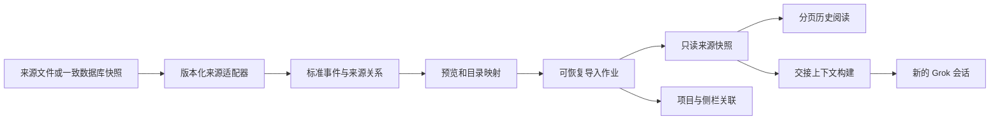

# 会话与工作区导入：产品方案与分批开发计划

日期：2026-09-08。状态：**待开发**。本轮只完成调研、方案与分支准备，不代表功能已实现。

方案版本：v0.2。新增：[实施契约](2026-09-08-session-workspace-import-contracts.md)与[验收矩阵](2026-09-08-session-workspace-import-acceptance.md)。产品范围以本页为准，数据/状态/API 以实施契约为准，测试是否完成以验收矩阵的实际证据为准。三者存在冲突时先修正文档，不自行挑选较宽松解释。

分支：`feat/session-workspace-import-design`；基于上游 `30757366a739ec9aaf0ccc95bbb3efe19a067aa9`。依据：[调研报告与固定源码](../research/2026-09-08-session-workspace-import.md)。

## 1. 产品目标与支持范围

用户可以把 Codex、Claude Code、Cursor 中做过的工作搬进 Grok App：找得到原会话、看得懂工具与附件、关联正确项目，并带着关键上下文继续工作。Windows、macOS、Linux 使用同一领域模型和导入流程。

### 首版完整范围

| 能力 | 首版行为 |
|---|---|
| 来源 | Codex 本地历史；Claude Code / 兼容 SDK transcript；Cursor 已验收的 Composer、Store、transcript 版本；已有通用文件导入 |
| 发现 | 扫描已知应用根；支持自定义根、手动文件/目录和其他电脑带来的源资料副本；不要求登录原平台 |
| 会话 | 预览、筛选、多选、原始时间、标题、来源、工具历史、存在的附件、可解释的分支/压缩信息 |
| 工作区 | 目录和名称、会话归属、可获得的项目分组、多根目录逐个映射；项目缺失可先导入历史 |
| 续聊 | 从选定来源快照/分支创建 Grok 子会话，准备可编辑交接内容，明确上下文覆盖范围 |
| 可靠性 | 重复导入不重复创建；手动检查新增；取消、部分成功、失败重试、崩溃恢复、撤销导入 |
| 原数据 | 扫描和导入只读，源格式未知时报告，不修改外部账号配置、历史或项目文件 |

本地导入器不调用外部 CLI 或模型；但现有 App 首次进入工作台要求 **Grok Build CLI 已安装且可运行**，见 [setup.md](../llm-wiki/setup.md)。首版保留这个启动门槛，登录可跳过；“离线导入”指完成初始化后的本地导入。尚未安装 Grok CLI 也能进入独立阅读模式属于后续产品改动，本计划不暗中放开 setup gate。

“工作区导入”首版是恢复**项目组织和执行目录关系**，不是复制整台电脑的工程环境。项目文件已在本机可直接关联；换机后可重选目录。缺少代码时仍能阅读历史，开始工具执行前必须选定可用目录。聊天中的补丁、文件内容和 checkpoint 不自动写回项目。

后续扩展：便携迁移包、可选工程文件快照、DSH/pi 专用适配器、用户开启的持续增量同步。各平台云端历史、Claude 网页/Cowork 专用格式、原平台原生恢复不纳入首版承诺。

## 2. 交互与页面融合

主入口放在侧栏项目/新建菜单的“导入会话与工作区”；项目菜单中可“导入到此项目”。设置 → 通用 → 应用增加一个可搜索的“导入记录”入口，深链到同一领域面板，不新增一套账户页面。

旧“导入对话”入口兼容跳转到向导的文件模式；解除账号已登录才可使用的限制。Grok CLI 会话管理保留原生恢复逻辑，可在统一入口中引导过去，但不混用来源 ID。

向导采用项目现有面板/GlassModal 体系，大窗口两栏、小窗口按步骤显示，不把全部设置挤在一屏。步骤为：

1. **选择来源**：Codex / Claude Code / Cursor / 文件；显示找到的根、数量和读取状态；可更换位置。
2. **选择内容**：左侧按工作区分组，右侧会话列表和按需预览。默认时间范围为全部、按最近活动排序、每页 50 条、不预选会话；“全选当前结果”绑定一次扫描快照，后发现的条目不偷偷加入。侧栏显示全部发现数与问题数，时间筛选不会伪装成扫描总量。
3. **对应项目**：为源目录选择已有项目、新建项目记录、映射到新目录或暂不关联。显示原路径与目标路径，多根工作区逐根确认。
4. **导入**：显示已完成/总数、当前会话、问题数；后台可继续正常聊天；取消立即停止新工作，已完成项保留。
5. **结果**：只呈现成功/部分成功/失败计数和“查看会话”“重试失败项”；技术损失详情按需展开。

扫描错误不能写“未找到会话”：分别显示未安装、路径无权限、数据库忙、格式不支持、正文缺失。单个失败不阻断其他来源。预计空间不足时在写入前报告所需空间。

导入历史在项目侧栏有小来源标记，打开使用现有 Markdown 与附件样式；工具默认折叠，只显示历史状态。底部主动作“在 Grok 中继续”，点击进入交接预览和新会话。导入期间仍能选取/阅读已经完成的会话，不能用整个应用的 busy 锁。

项目下将“导入的历史”折叠为独立分组，默认导入后展开本批结果；新 Grok 子会话出现在正常会话区，并提供“查看来源”返回入口。原始标题不变，用户重命名仅写本地别名。重新导入同一批提示“已有记录”而不刷出副本。关闭面板只隐藏进度；显式“取消导入”才停止作业。空工作区可单独导入，只有元数据而没有可读正文的会话不能伪装成完整聊天。

全局会话搜索增加独立的导入历史查询来源，结果带类型和来源标记，通过 typed navigation 打开对应阅读器；不能把 `imp:` 强塞给既有原生搜索结果的 sessionId。导入页支持复制选段、导出当前选定分支的可读 Markdown，导出明确标记来源与损失；完整便携包仍是后续工作。导入本身不产生新消息未读、运行中标记、通知或本应用 token/费用统计，原来源用量仅作历史信息显示。

### 工作区映射规则

- 自动建议优先级：来源显式工作区记录 → 会话可信 cwd；用户显式映射覆盖建议。编码目录名仅作提示，不当可逆编码。每条映射记录证据和用户选择，不能从一个路径相似的会话推断整批项目归属。
- Cursor 的 `workspace.json` 可能指向单目录，也可能指向 `.code-workspace`；后者按 JSONC 读取 `folders`，相对目录以 workspace 文件所在目录解析。只读取根目录/名称，不执行 tasks、launch、扩展推荐或应用其中的设置。显式无会话的工作区也可导入；只有 cwd 证据的来源显示“从会话推断”。
- 项目身份为 `host kind + host identity + canonical path`。Windows 盘符/大小写、POSIX 大小写、UNC、WSL 和 SSH 分开处理；只有存在且同一文件系统语义的路径才 realpath 去重。
- 不把 `C:\repo`、`/mnt/c/repo`、`/home/me/repo` 自动当成同一路径。WSL 需要 distro 身份；SSH 需要已配置 host。首版不自动 SSH 拉远端历史，允许导入离线资料后映射已有远端项目。
- 多根 workspace 在导入目录中保留完整 roots 关系；Grok 执行选择一个 primary root。为新项目可创建现有 Space 分组；既有项目保留原 Space，避免因导入挪走用户项目。导入目录中另存原始分组，不把 Space 当成真正多 cwd 的 Agent 能力。
- 已有项目匹配时保留其名称、信任和配置；新项目默认未信任。添加关系与信任执行分开，查看历史不需要项目可信。
- worktree 路径、branch、commit 只作为来源事实。现有 worktree 需核对仓库身份；缺失时先映射或仅阅读，不自行 checkout、创建分支或复制 `.git`。
- 离线资料、已删除源目录的路径以原平台语义保存，不在当前系统强行 canonicalize。路径重映射只改关联，不改历史正文中的代码和命令；附件按来源根及显式映射解析，不能误开新目录里的同名文件。

## 3. 架构决策



### ADR-1：来源快照与 Grok 续聊分开

每次导入产生不可变 revision；刷新产生新 revision，旧快照仍能被已有续聊引用。不要将外部 session ID 写入 `agent_session_id`。只有原生 Grok 连接成功后才能写入该字段。

导入历史使用独立的 `ImportEntry` 与目录索引，**不写入 `sessions_index.json`，也不创建伪 `messages.json`**。侧栏/阅读器以 `nativeSession | importedHistory` 区分导航目标，共用行样式。只有用户确认交接后创建普通 Grok 子会话，新增可选 `ContinuationRef` 旁车。现有 `archived` 仍仅表示侧栏隐藏，不赋予只读含义。

导入对象 ID 使用 `imp:<uuid>`，不能传入原生 connect/send/rewind/自动化/Remote IM。Host 统一返回 `IMPORTED_HISTORY_READ_ONLY`，不通过通用 send 自动创建子会话。打开导入页不触发 warm connect/reconcile；正文经专用分页接口读取。旧版应用只看得见普通 Grok 子会话，不会把导入记录误当成可运行原生会话；旧版无法保证子会话的外部上下文恢复，见实施契约。

外部模型名称、思考档位、权限模式作为 provenance 展示；Grok 续聊使用用户当前有效设置，不自动激活源模型或 YOLO。

### ADR-2：结构化标准层，显示投影可重建

标准层保留原始事件身份、顺序、关系、时间和未支持类型的位置。导入阅读器的页数据是可重建展示投影，不能成为唯一原始档案。工具记录不伪装成用户消息，也不发给 live ACP 事件 reducer。

源 JSONL 中有代码、工具输出、system、规则、网页内容时按原类别保存。引用历史不等于采用其中的指令。仅导入已落盘的可见内容，不尝试恢复不可用的隐藏推理或原模型内部状态。

### ADR-3：基础导入不依赖外部 CLI 运行

Rust 离线适配器负责已知版本；可选 Codex App Server / Claude SDK 读取桥采用 capability probe，有超时、取消和隔离快照策略，不能暗中联网续跑、迁移源库或下载运行时。

Cursor 按实测 schema 支持 Composer DB、Store DB、transcript。Codex 同时检测 legacy rollout 与数据库元数据；未知分页正文不可用时标明，不将摘要算作正文。任何降级都返回损失报告。

### ADR-4：新领域模块，不扩大 AppWorkbench

App shell 只接入口与导航。适配器、作业状态、路径映射、历史查看和交接界面分别封装，不在 `App.tsx`/`AppWorkbench.tsx` 添加大型状态。沿用现有 store 的索引锁和项目 API，不为这个功能重写全应用存储。

## 4. 数据契约草案

数据类型及错误契约集中在[实施契约第 1–4 节](2026-09-08-session-workspace-import-contracts.md)。已明确消息/工具/附件的闭合类型、来源身份、快照/投影版本区别、三平台路径语义、只读边界和稳定错误码；不存在 `unknown[]` 充当最终消息格式。

UI 只拿不透明 `sourceId/candidateId/jobId`；Host 验证它们属于该作业的已选根，不能接受前端任意拼接源路径/SQL/目标 session ID。预览结果附 revision，写入前核对源未变化；变化则重新预览该项或导入已经固定的快照，不能预览 A、提交 B。

### 存储与提交

使用已有 rusqlite 依赖建立导入专用 catalog，放在 `{app_data}/imports/`；原 App sessions JSON 协议保持兼容。schema v1 草案与唯一约束见实施契约，P0 用样本验证后冻结。

```text
imports/
  catalog.sqlite                 # jobs、来源身份、revision、issues、引用
  staging/<job>/<candidate>/      # 尚未发布的本次资料
  entries/<importId>/<revision>/
    manifest.json
    events.jsonl                 # 标准事件，可流读
    event-index.sqlite           # 派生页边界/偏移/检索索引；按需读取
    assets/<digest>.<ext>
    source/                     # 仅选中记录；按保留选项存储
sessions/<appSessionId>/          # 只有续聊才创建，存后续原生 Grok 消息
  import_continuation.json       # 固定 revision、范围和交接派发状态
```

源 raw 字节级保留为可选项；默认保留标准事件和所选附件、来源 hash 与定位。不整份永久复制混有凭据的 globalStorage 数据库。需要的临时一致快照在本次作业后清理；启用原始保留也只保留选中的会话记录。未知内容默认保留类型、位置和占位；未保留 payload 时以后重解析需要重新选源，报告不能宣称无损。隐藏/撤销/永久清理、续聊引用与最短存储寿命按实施契约执行。

单项提交：持久化 prepared receipt（预分配导入 ID）→ 写 staging 并验证 → 同卷原子发布 revision 目录 → 通过现有锁关联 project → catalog 标记 committed 并更新展示版本。导入不写原生 session 索引；创建续聊另用带预分配 session ID 的幂等发布接口，不能直接反复调用现有 `create_session`。跨项目 JSON 与 SQLite 使用可恢复 receipt，不能假装一个事务。重启只修复已经授权的本地提交，不自动重新扫描外部源。

导入项目通过既有 store API 幂等创建；预览不写项目。取消保留 committed 项、清理未提交 staging；atomic publish 区间完成后停止。撤销只删除本次拥有的且没有用户后续修改/引用的对象；续聊子会话和它依赖的快照必须保留。既有项目及磁盘工程目录永远不属于撤销删除范围。

## 5. 格式、去重与完整性规则

| 情况 | 决策 |
|---|---|
| 相同来源身份、相同 revision | 返回已有导入，零重复创建 |
| 源记录正常追加 | 手动刷新生成新 revision；原子切换归档显示；已有 Grok 子会话固定原 revision |
| 源截断、重写、ID 冲突 | 保留两个 revision 或要求选择，不能直接追加进当前对话 |
| 同一 Cursor ID 出现在 DB/JSONL | 按版本化来源优先级和身份核对选正文；来源冲突明确报告，不盲拼接 |
| 不同来源恰好内容相同 | 只提示可能重复，不按标题或全文 hash 合并不同会话 |
| 跨电脑备份的相同会话 | native ID + lineage + 内容摘要验证后关联；无法确认来源实例时保留独立副本 |
| JSONL 尾行写了一半 | 只固定完整记录前缀，报告“源仍在写入”；下次刷新补齐 |
| 中间损坏/未知版本 | 显示位置与影响；可以保留可读部分，但不能标完整成功或悄悄跳过 |
| 工具缺调用/缺结果 | 显示未配对/结果未知，不显示成功，不自动重放 |
| 分支、回退、压缩 | 保留关系和边界；选定叶节点才能生成线性上下文；不能确定 leaf 时要求选择 |
| 附件丢失/超限 | 占位及原因；能读的会话仍可部分导入；原始路径不可直接当可访问资源 |

`complete` 指该适配器已验收的可读内容完整导入，不代表恢复原运行时。每项报告记录消息/工具/附件的预期与实际计数，以及未知/跳过/缺失数；来源无法给出预期数时写未知，不能用已解析数倒推出“100%”。列表保留来源时间，另存 importedAt；不让一次导入把所有旧会话都伪装成今天创建。

SQLite 读取使用 `mode=ro`、只读事务/online backup 和 bounded busy timeout，计划增加 rusqlite `backup` feature；P0 验证源库 WAL 行为、锁和三平台支持。`mode=ro` 不等于源目录绝对零文件变化：SQLite 可能需要现有 WAL/SHM 辅助文件。源数据库不执行 checkpoint/VACUUM；不使用 `immutable=1` 忽略活 WAL。若无法以既有源辅助文件完成读取而不新建/修改源文件，则转为提示用户提供关闭应用后的完整副本。跨多个 DB 不存在天然共同快照，按实施契约核对引用完整性并报告无法确定的部分。

文件遍历有限深度、数量和大小预算，默认不跟随跳出已选根的 symlink/junction。附件复制按 canonical containment、文件类型、大小和摘要验证；URL 附件首版只显示链接，不自动联网补抓；私有或过期链接可能无法恢复。Markdown/HTML、文件链接和外部图片渲染沿用项目媒体交付规则，禁止脚本执行。

任何历史都可能夹带用户曾粘贴的凭据。导入不扫描账号密钥文件、不把正文写日志；可选原始资料和交接预览提示可排除内容。已知 secret 模式检测只能辅助，不能声称自动脱敏完整。扫描与阅读不调用模型；续聊时才发送预览中选定的上下文。

## 6. 真正能用的续聊

“在 Grok 中继续”先生成本地确定性交接预览，包含来源/分支、用户选定的关键记录、最近完整问答、可用的压缩摘要、已记录的变更/测试结果引用、待续内容和目标目录。没有来源证据的结论不自动编造；无法推断目标时保留用户可编辑的“接下来做什么”。

预算按当前模型窗口、现有指令/附件/工具开销和输出预留计算；已知窗口下导入上下文建议上限为 `min(窗口的 10%, 12k tokens, 当前剩余输入预算)`，这是待基准测试的初值。未知窗口采用保守估计与字符兜底。超限保留完整最近回合和用户钉选片段，不静默截断到半个工具调用；显示已带入范围和其余记录数量。空间不足则要求缩减，不偷偷省略已钉选内容。

首版默认不调用模型做额外总结，避免导入耗时和费用。后续可选“整理交接摘要”，单独显示进度、费用提示、失败回退；摘要保存来源引用和摘要模型，不能覆盖原历史。

剩余历史通过新的、会话范围内只读检索能力 `import_history_search` / `import_history_read` 按需读取。授权同时约束 revision、分支、记录及字段，不是只绑定整份来源。用户排除的段落、子代理、附件和 system 信息不得借工具再次进入模型。默认包含选定主链可读 user/assistant 与工具记录；子代理、可见 thinking、图片内容和来源指令分别明确选择。

工具计划以应用二进制的独立 stdio MCP 模式实现，不增加 Node/Python 运行依赖，不写共享 `~/.grok`。现有 ACP MCP 配置只有 cwd，没有 App session 身份，且 SSH 会清空本地 MCP；因此 P6 必须增加逐次 open 的会话作用域注入、工具可用性验证和授权隔离。三平台本地运行时为完整续聊目标；WSL/SSH/远端 ACP 未验证时仅允许明确选择的“仅携带交接片段”模式，不能假装可检索全部历史。详见实施契约第 6 节。

交接 payload 必须真的进入 ACP `session/prompt`；测试检查传输内容而非仅检查页面文字。它替代该子会话的通用首次 bootstrap，防止前缀重复。续聊创建幂等不代表模型执行恰好一次：派发后断线可能已执行工具；状态未知时不得自动重放，先核对原生持久化回合，无法核对就让用户选择。Grok 原生 session/load 后沿用其历史；恢复失败则从固定引用与本地后续回合构建恢复预览，不悄悄切换最新源版本。

验收场景：早期用户明确约束发生在 100 轮以前，最后消息只有“继续”。用户钉选该约束或模型通过范围内检索找到它后，实际发出的上下文中必须存在该约束及对应来源；不能只返回“能继续聊”。

## 7. 模块落点

| 模块 | 职责 |
|---|---|
| `src-tauri/src/session_migration/`（新增） | types、detect、各 adapter、snapshot、normalize、catalog、jobs、workspace_map、continuation |
| `src-tauri/src/commands/session_migration.rs`（新增） | 窄 Tauri 命令；磁盘/解析进入后台工作线程 |
| `src/lib/api/sessionMigration.ts`（新增） | 领域 IPC 类型与调用 |
| `src/hooks/useSessionImport.ts`（新增） | 向导、job subscription、过期请求隔离 |
| `src/components/session-import/`（新增） | 来源/预览/映射/进度/结果/交接；复用 Select、GlassModal、ContextMenu |
| `src/lib/sessionImport/`（新增） | 前端纯决策、来源标签、筛选/映射展示 |
| `store.rs`、session manager、session attach | 幂等续聊发布、统一 ID guard、旁车读取、引用与上下文接缝 |
| `acp_client.rs`、MCP 构造、早期 CLI 分派 | 会话作用域工具、每次 open 注入、独立 stdio 读取模式 |
| `src/lib/settingsCatalog/`、15 个 i18n catalog | 搜索入口、深链、所有空/错/忙/部分成功文案 |

适配器接口为 `probe → discover(page) → inspect(candidate) → read(snapshot) → normalize`。具体 Tauri 命令与状态见实施契约。事件仅提示状态变化，Host 状态是事实来源；先订阅并缓冲事件，再拉带序号状态、丢弃旧事件，避免“先拉状态后订阅”漏掉完成事件。

## 8. 分批开发计划

每个切片单独分支/提交，合并后再基于最新主干开始下一片，或在明确依赖的堆叠分支开发。计划不自动创建 PR；实现完成后逐批交付可审核结果。

| 切片 | 内容和边界 | 必须通过的验收 |
|---|---|---|
| P0 格式样本与契约 | 固定三家实际版本；合成/脱敏 fixtures；标准事件、loss report、路径/身份策略；测 SQLite 快照方案 | 明确“支持/部分/不支持”矩阵；不能用字符串存在性测试代替解析结果 |
| P1 作业与归档基础 | 独立 catalog、receipt、恢复/取消/撤销、分页接口、原生命令 guard；通用文件走新管线、旧入口兼容 | 不写伪原生 session；重复/崩溃/多窗口不重复创建；旧格式可用；代码块不误分角色 |
| P2 Codex 适配器 | rollout、元数据、归档/分支/回退；可用项目根；不支持的 historyMode 显式报告 | 事件/工具无双份；cwd/归档正确；所有 fixture 有完整性结论 |
| P3 Claude Code 适配器 | 标题/UUID/父关系、工具块、附件、压缩、子代理、定制 config 根 | 不可逆路径不误绑定；工具结果不作用户气泡；主链和 sidechain 正确 |
| P4a Cursor transcript / Composer | JSONL、workspace/global SQLite、旧 Chat；consistent snapshot | 活库 WAL 可见；正文与索引正确组合；锁错误不显示零会话 |
| P4b Cursor Store 与跨来源 | store.db/blob、ACP 根、多代兼容、身份聚合/冲突 | 同会话多来源不重复；正文不足明确 partial；未知 schema 不伪装成功 |
| P5 向导与工作区整合 | 完整 UI、路径映射、多根分组、全局搜索、可读导出、15 语言；设置与侧栏入口 | 三平台导入阅读；批量中仍能选消息/聊天；跳过账号可用；不污染未读/费用统计 |
| P6a 续聊与只读工具传输 | 二进制 stdio 模式、逐 session MCP、范围授权、tools/list 验证与失败状态 | 官方/自定义 + shared/independent 本地矩阵通过；普通会话不增加工具；跨会话与排除内容不可读 |
| P6b 交接与派发恢复 | 预览、预算、旁车、幂等子会话、prompt 与断线语义 | ACP 收到上下文；旧约束可引用；排除项不泄漏；未知派发不重放；失败恢复不重复前缀 |
| P7 联调与发布收尾 | 源版本/OS 矩阵、压力与故障注入、增量刷新、撤销、文档/迁移说明 | 下节关键场景全通过；关闭所有影响首版承诺的缺口 |

依赖：P0 → P1 → 各来源适配器 → P5 → P6a → P6b → P7，共 **10 个切片**。P5 的 UI 可提前用 fixture 开发，但三家来源和 P6b 完成前不对外宣称首版完成。P4 与 P6 分片，避免存储适配和运行时接入挤成巨大 PR。

旧版方案的 3–5 周仅是调研初估；补查发现还需会话作用域 MCP、独立分页阅读和派发恢复，暂不据此承诺工期。P0 获得三平台样本和协议验证结果后，按这 10 个切片重新估算。

### 第一批具体工作

- [ ] 建立合成 fixture 清单：每家至少一个普通会话、工具回合、缺失路径与损坏样本；Codex 回退/重复事件、Claude sidechain、Cursor 多存储追加专项。
- [ ] 用样本检验实施契约中的来源 ID、revision、workspace map、loss report、独立导入对象和 job receipt schema，再冻结 v1。
- [ ] 用合成 WAL 数据库验证 backup feature、跨 DB 引用核对、源辅助文件零变化和取消行为。
- [ ] 验证本地 Grok 的逐会话 MCP 注入与可用性探测；确认 shared/independent、官方/自定义四种组合均不会丢弃应用必需工具。
- [ ] 为每个支持来源指定实际版本、证据路径和预期事件数；未知版本进入显式错误分支。
- [ ] 形成 P0 评审材料，再开发写入和完整向导，不先放一个空按钮。

## 9. 验证与性能目标

性能为**待验证目标**，不代表已测结果：本地 SSD、1 万条会话元数据时，首批 50 条可选结果目标 2 秒内；选择已索引会话的首屏目标 500ms 内；取消请求得到 UI 确认目标 300ms 内，后台句柄释放/清理另计。热缓存与冷启动分别记录，正文扫描和附件复制持续显示进度，不要求未知网络盘达到 SSD 指标。

扫描只读取必要摘要，正文按选择解析；读写并发分别限流，磁盘任务不阻塞 Tauri async/UI。前端分页/虚拟列表不拿全量 transcript；100MB 单会话、1GB 批次用流式解析和磁盘索引测试，监测峰值内存/磁盘空间。资源上限初值见实施契约第 7 节，触发须报告，不静默丢历史；P0 测量后才冻结发布值。

必须覆盖：

- Windows、macOS、Linux 本地导入和重启；Windows UNC/中文/空格/长路径，POSIX 大小写，WSL/SSH 映射与 missing cwd。
- 同批重复、多窗口导入、源持续写入、预览后变化、尾行损坏、中间损坏、未知 schema、源库 WAL/忙、磁盘满、权限错误。
- 每个 publish/索引/ledger 边界杀进程后恢复；取消/重试/撤销不影响源数据和其他会话。
- 多根工作区、已有项目和信任设置不被覆盖；撤销不删工程目录，不断开已继续工作的子会话。
- 文本/图片/文件/工具、分支/压缩/回退、原始时间、重复投影、源来源冲突和所有损失计数。
- 超大附件、路径穿越、symlink/junction 越界、恶意 HTML/Markdown、历史中的指令和命令都不执行。
- 连续快速切换来源/预览、关闭并重开向导、取消旧扫描再启动、浅深主题与缩放、键盘焦点、15 语言。
- 已安装运行时、跳过账号后离线导入；未安装运行时仍走原 setup gate；模型调用只出现在用户触发续聊/可选摘要时。
- 普通 Grok 会话、CLI 导入、原生恢复、移动项目、会话引用、附件、导出、自动化和 Remote IM 回归。

每个实现 PR 执行仓库要求的相关测试，并在集成前完成 `pnpm typecheck`、`pnpm test`、`pnpm lint`、`pnpm build:ui`、`cargo fmt --all -- --check`、`cargo clippy --all-targets -- -D warnings`、`cargo test`。测试源码 fixture 不得含私人 transcript、凭据或真实敏感路径。新文件使用 UTF-8/LF。

本轮是 docs-only：验证相对链接、固定来源链接、文档格式与分支改动范围，不运行产品构建，不将文档检查表述成导入功能测试。

## 10. 后续扩展

便携包建议包含版本化 manifest、标准事件、来源关系、所选附件和路径映射建议，按 DSH 的分块归档思路实现；导入先检查条目数/展开总量/摘要/路径，拒绝 Zip Slip 和压缩炸弹。工程文件为额外可选部分，必须预览文件清单、单独选择目标并处理覆盖冲突；`.git`、凭据、依赖缓存不默认打包。

DSH 适配优先从官方 ZIP 导出开始，再支持明确版本的压缩原始日志；pi 从 JSONL v3 和树开始。规则、Skills/MCP/插件迁移另用设置迁移流程，不能随聊天导入自动启用可执行内容。持续同步以后也只更新归档 revision，不把两个运行时的活会话混写在一起。
